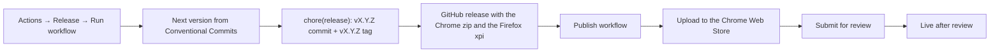

# Releasing

Releases are started by hand. After that, the Chrome Web Store step is automatic. The Firefox Add-ons (AMO) upload is a manual step: see [Firefox (by hand)](#firefox-by-hand).



| Workflow | Trigger | What it does |
|---|---|---|
| `.github/workflows/ci.yml` | push to `main`, pull requests | Checks commit messages, type-checks, runs tests, builds and uploads the Chrome zip and the Firefox xpi as an artifact |
| `.github/workflows/release.yml` | manual (Actions tab) | Picks the version, commits it, tags `vX.Y.Z`, creates the GitHub release with the Chrome zip and the Firefox xpi, calls Publish |
| `.github/workflows/publish.yml` | called by Release, or manual with a tag | Uploads that release's Chrome zip to the store and submits it for review |

The packages are `packages/copy-title-url-ext.v<version>.chrome.zip` and `packages/copy-title-url-ext.v<version>.firefox.xpi`, built by `npm run package`.

## How the version is chosen

The Release workflow looks at the commits since the last `v*` tag (see [CONTRIBUTING.md](../CONTRIBUTING.md)):

- any breaking change → major
- otherwise any `feat` → minor
- otherwise any `fix` or `perf` → patch
- otherwise nothing to release; the run fails and says so

The **bump** input overrides this (`patch`, `minor`, `major`). **Dry run** prints the version and notes in the run summary and changes nothing.

The last tag is `v0.0.3`. The commits that added this release setup are `build`, `ci`, `test` and `docs` commits, so they release nothing. Run the first automated release with **bump = patch** (`v0.0.4`).

The Chrome Web Store and AMO only accept a package whose version is higher than the last uploaded one, so never move or reuse a tag.

## Existing listings

Both store listings already exist, so there is nothing to create:

- Chrome Web Store: item `eepifgllapjhlplohodldfjlipmbeeij`, <https://chromewebstore.google.com/detail/copy-title-and-url/eepifgllapjhlplohodldfjlipmbeeij>.
- Firefox Add-ons: `copy-title-and-url-ext`, <https://addons.mozilla.org/en-US/firefox/addon/copy-title-and-url-ext/>.

Listing copy for both stores is in [`store/listing.md`](../store/listing.md).

## Automation setup (once)

The Publish workflow authenticates to the Chrome Web Store API as a Google Cloud **service account**, using **Workload Identity Federation**: GitHub's OIDC token is exchanged for a short-lived access token, so no key or refresh token is stored in GitHub.

### 1. Google Cloud service account

Install the [gcloud CLI](https://cloud.google.com/sdk/docs/install).

A Chrome Web Store publisher can link only one service account. If `cws-publisher` and the `github` pool already exist from `due-date-highlighter-ext`, use that project, skip the create commands, and run only `providers create-oidc copy-title-url` and the `add-iam-policy-binding` for this repository.

```sh
PROJECT_ID=due-date-highlighter          # any new or existing project
REPO=casteroid/copy-title-url-ext
SA=cws-publisher

gcloud projects create "$PROJECT_ID"      # skip if it exists
gcloud config set project "$PROJECT_ID"
PROJECT_NUMBER=$(gcloud projects describe "$PROJECT_ID" --format='value(projectNumber)')

gcloud services enable chromewebstore.googleapis.com iamcredentials.googleapis.com sts.googleapis.com

gcloud iam service-accounts create "$SA" --display-name="Chrome Web Store publisher"

gcloud iam workload-identity-pools create github --location=global --display-name="GitHub Actions"

gcloud iam workload-identity-pools providers create-oidc copy-title-url \
  --location=global \
  --workload-identity-pool=github \
  --issuer-uri="https://token.actions.githubusercontent.com" \
  --attribute-mapping="google.subject=assertion.sub,attribute.repository=assertion.repository" \
  --attribute-condition="assertion.repository == '$REPO'"

gcloud iam service-accounts add-iam-policy-binding "$SA@$PROJECT_ID.iam.gserviceaccount.com" \
  --role=roles/iam.workloadIdentityUser \
  --member="principalSet://iam.googleapis.com/projects/$PROJECT_NUMBER/locations/global/workloadIdentityPools/github/attribute.repository/$REPO"

# Values for the GitHub variables below:
echo "GCP_WORKLOAD_IDENTITY_PROVIDER=projects/$PROJECT_NUMBER/locations/global/workloadIdentityPools/github/providers/copy-title-url"
echo "GCP_SERVICE_ACCOUNT=$SA@$PROJECT_ID.iam.gserviceaccount.com"
```

The attribute condition means only workflows in this repository can use this provider.

### 2. Link the service account to the store

In the [Developer Dashboard](https://chrome.google.com/webstore/devconsole/), open **Account**, add the service account email (`cws-publisher@<project>.iam.gserviceaccount.com`) under the service account section, and save. Skip this if it is already linked. On the same page, copy the **Publisher ID**.

### 3. GitHub variables

None of these values are secrets, so they are repository variables:

```sh
gh variable set CWS_PUBLISHER_ID --body "<publisher id>"
gh variable set CWS_EXTENSION_ID --body "eepifgllapjhlplohodldfjlipmbeeij"
gh variable set GCP_WORKLOAD_IDENTITY_PROVIDER --body "projects/<number>/locations/global/workloadIdentityPools/github/providers/copy-title-url"
gh variable set GCP_SERVICE_ACCOUNT --body "cws-publisher@<project>.iam.gserviceaccount.com"
# Optional: STAGED_PUBLISH waits for you to press Publish in the dashboard after approval.
gh variable set CWS_PUBLISH_TYPE --body "DEFAULT_PUBLISH"
```

Until `CWS_EXTENSION_ID` is set, the Publish job logs `CWS_EXTENSION_ID is not set` and skips.

Publishing runs in the `chrome-web-store` GitHub environment, which GitHub creates on the first run. To approve every store submission by hand, add yourself as a required reviewer under **Settings → Environments → chrome-web-store**.

### 4. Check it

Run **Release** with **bump = patch**. The Publish job should log `Upload: SUCCEEDED` and `Submitted for review`.

## Every release after that

1. Merge or push your Conventional Commits to `main` and wait for CI to pass.
2. **Actions → Release → Run workflow** on `main`. Optionally run a dry run first to read the notes.
3. Watch the review in the dashboard. With `DEFAULT_PUBLISH` the version goes live as soon as it is approved.
4. Upload the same version to Firefox Add-ons by hand (next section).

To retry only the store step for an existing release (for example after fixing the GitHub variables), run **Actions → Publish to Chrome Web Store** with the tag, e.g. `v0.0.4`.

## Firefox (by hand)

1. Download `copy-title-url-ext.v<version>.firefox.xpi` from the GitHub release.
2. In the [AMO Developer Hub](https://addons.mozilla.org/developers/), open the add-on and click **Upload New Version**. Upload the xpi.
3. The xpi is a webpack bundle, so AMO asks for the source code. Upload an archive of the tag:

   ```sh
   git archive --format=zip -o source.zip v<version>
   ```

   The build steps in [README.md](../README.md) are the build instructions reviewers need.

## Troubleshooting

| Symptom | Cause and fix |
|---|---|
| Release fails with "nothing to release" | Only `docs`, `chore` and similar commits since the last tag. Pick a bump explicitly if you really want a release. |
| Release fails with "manifest says X but the last release tag is Y" | Someone changed the version by hand. Put `app/manifest.json` and `package.json` back to the tag's version. |
| `git push` in Release is rejected | `main` moved while the workflow ran, or branch protection blocks the bot. Rerun; with branch protection, allow GitHub Actions to push to `main`. |
| Auth step fails with `Permission 'iam.serviceAccounts.getAccessToken' denied` | The `workloadIdentityUser` binding or the repository name in the attribute condition is wrong. |
| Upload returns 401 or 403 | The service account is not linked in the dashboard, or `CWS_PUBLISHER_ID` belongs to another publisher. |
| Upload fails because of the version | A package with that version was already uploaded. Release again; the new version will be higher. |
| Publish is refused while an item is in review | Wait for the review to finish, or cancel the pending submission in the dashboard, then rerun **Publish** with the tag. |
| Publish is refused after you changed visibility in the dashboard | Publish once by hand from the dashboard; the API then works again. |

References: [Chrome Web Store API](https://developer.chrome.com/docs/webstore/using-api), [service accounts](https://developer.chrome.com/docs/webstore/service-accounts), [google-github-actions/auth](https://github.com/google-github-actions/auth), [AMO source code submission](https://extensionworkshop.com/documentation/publish/source-code-submission/).
